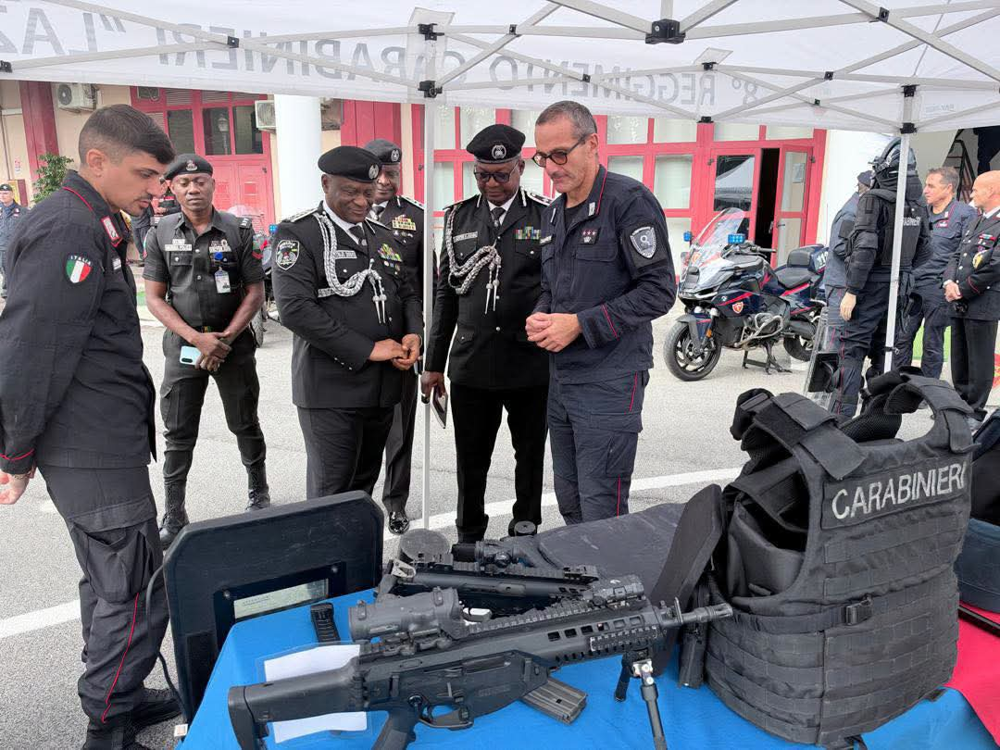
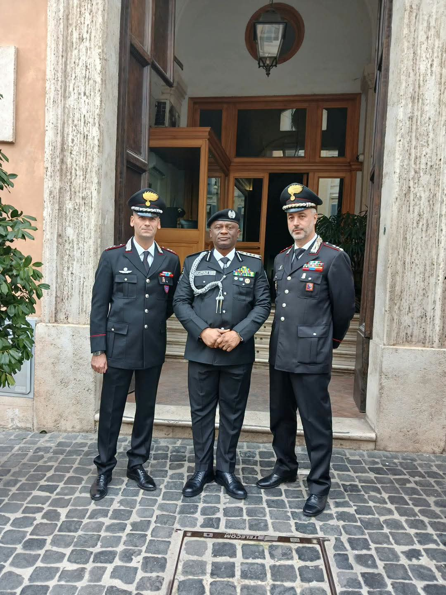
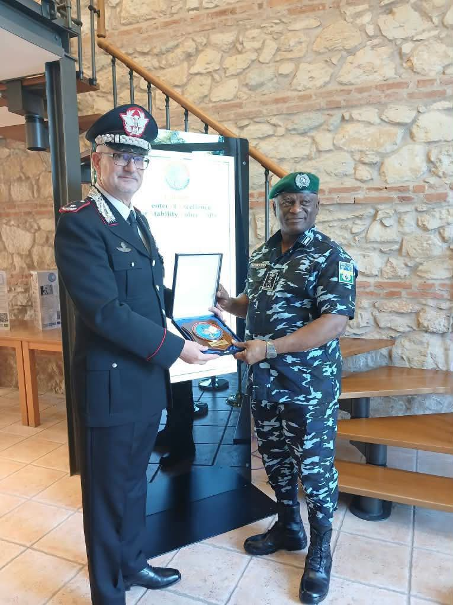
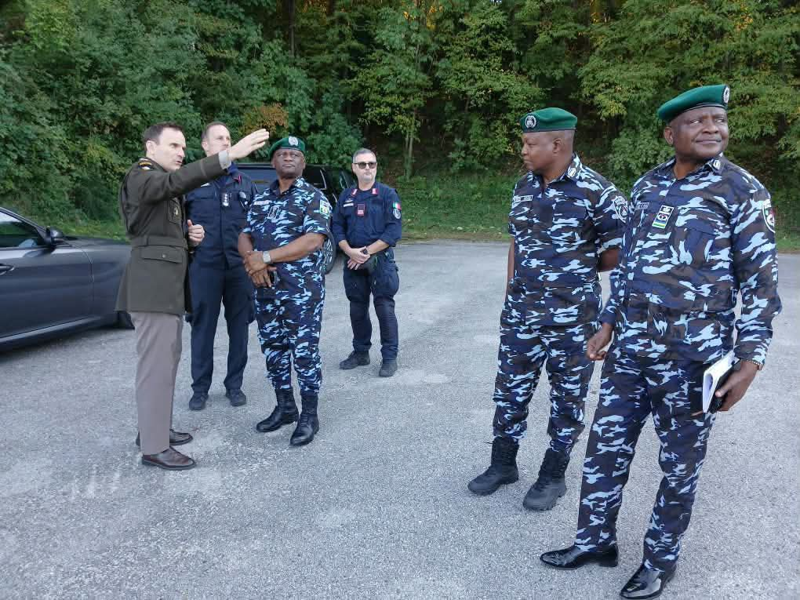

Nigeria's security challenges have become increasingly complex, demanding a police institution that is not only adequately equipped but also professionally trained, technologically advanced and capable of responding effectively to emerging threats. From terrorism and kidnapping to banditry, arms trafficking and cybercrime, the nature of insecurity confronting the country requires a new level of operational preparedness. It is against this background that the international security cooperation being pursued by the Inspector-General of Police, IGP Olatunji Rilwan Disu, deserves attention and commendation.

The proposed Nigeria United States Italy security partnership, with its emphasis on specialised training, intelligence-led operations, counter-insurgency and institutional development, presents an important opportunity to strengthen the operational capacity of the Nigeria Police Force. Particularly encouraging is the offer of specialised training for up to 5,000 police personnel, a proposal that, if properly implemented, could significantly improve the Force's response to security threats across the country.

For a nation battling criminal activities in forests, rural communities and other difficult terrains, specialised training is no longer a luxury; it is a necessity. Police personnel must possess the skills, tactical knowledge and intelligence capabilities required to confront criminals who increasingly operate with sophisticated weapons, communication systems and organised networks. The proposed training in tactical operations, explosives detection, digital forensics, cybercrime investigation, financial intelligence and anti-extortion techniques reflects an understanding of the changing nature of modern security threats.

We are particularly encouraged that the proposed programme extends beyond the Police Mobile Force to include other specialised units such as explosive ordnance disposal and forensic teams. This broader approach is important because effective policing cannot depend solely on tactical operations. Intelligence gathering, scientific investigation, evidence management and the ability to trace criminal finances are equally essential in dismantling organised criminal networks.

Equally significant is the proposed leadership development programme for senior and junior officers. A well-trained police force must also be a well-led institution. Operational effectiveness, discipline, accountability and respect for human rights depend greatly on the quality of leadership at every level of command. The proposed courses for 40 senior officers and 100 junior commanders could therefore contribute meaningfully to improving command structures and operational coordination.

Beyond training, the discussions at the Carabinieri Centre of Excellence for Stability Police Units in Vicenza offer another important dimension: the development of a national stability policing doctrine and standard operating procedures. This is an area that deserves particular attention. Nigeria needs a police institution guided by clear operational standards, especially in communities emerging from insurgency, communal conflict and other forms of violence. Restoring security must go hand in hand with protecting civilians, rebuilding public confidence and ensuring that police operations remain professional and accountable.

However, while international partnerships are welcome, Nigerians must also understand that the signing of agreements and the announcement of training opportunities are only the beginning. The real test lies in implementation. The proposed Memorandum of Understanding must translate into measurable outcomes, transparent arrangements and sustainable improvements in police operations. Training must not become another ceremonial exercise or an opportunity for a select few to benefit from foreign exposure without transferring the acquired knowledge to other personnel.

We also believe that the proposed technology transfer should be given serious consideration. Nigeria cannot continue to depend indefinitely on external partners for specialised equipment, technical expertise and operational support. Any cooperation must deliberately build local capacity, strengthen police training institutions and ensure that acquired skills and technologies can be maintained and developed within the country.

The invitation to the Italian Carabinieri assessment team to visit Abuja is therefore a welcome development. Such an assessment should identify the Force's most pressing needs and establish realistic priorities for implementation, with particular attention to areas facing serious security challenges.

Ultimately, the success of IGP Disu's international engagement should be measured by safer communities, improved investigations, stronger intelligence operations, reduced criminal activities and greater public confidence in the Nigeria Police Force. Nigerians are not merely interested in the number of officers who receive foreign training; they want to see the impact of that training in their daily lives.

We commend the Inspector-General of Police for pursuing international cooperation that recognises the importance of professional development, modern technology and institutional strengthening. Nevertheless, the Force must ensure that this promising initiative does not end with diplomatic engagements and official statements.

Nigeria needs a police force that can confidently confront contemporary security challenges, protect citizens and earn public trust. If effectively implemented, the proposed partnership could become a meaningful investment in that future.

